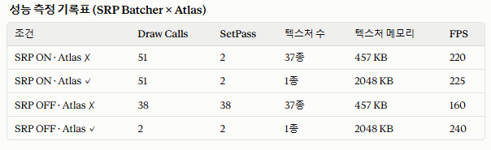
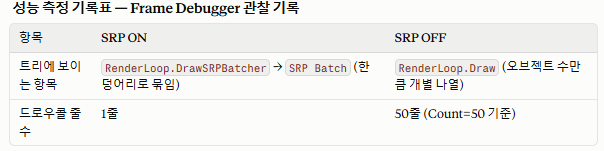
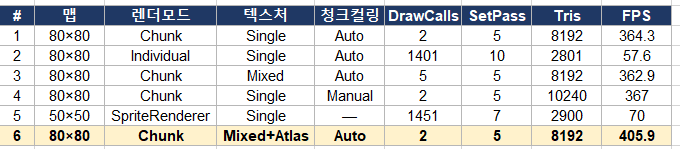
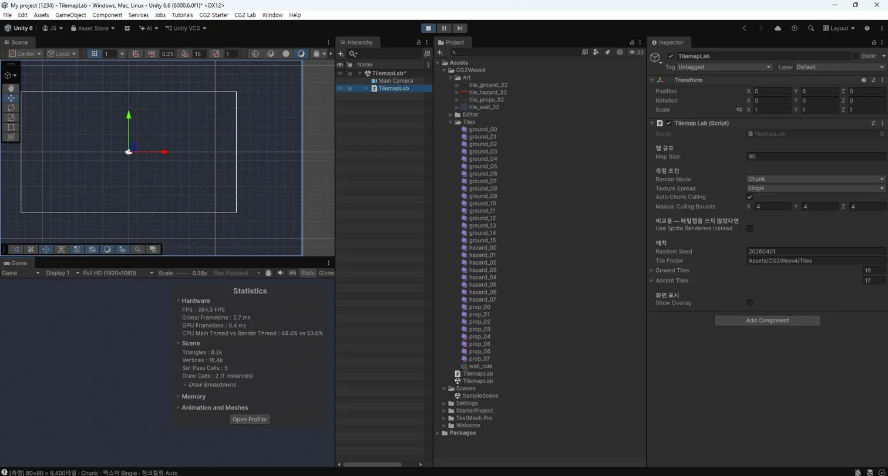
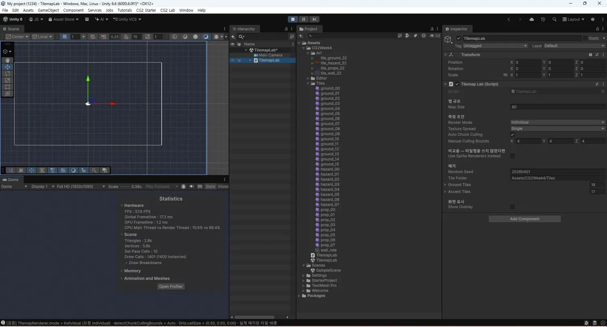
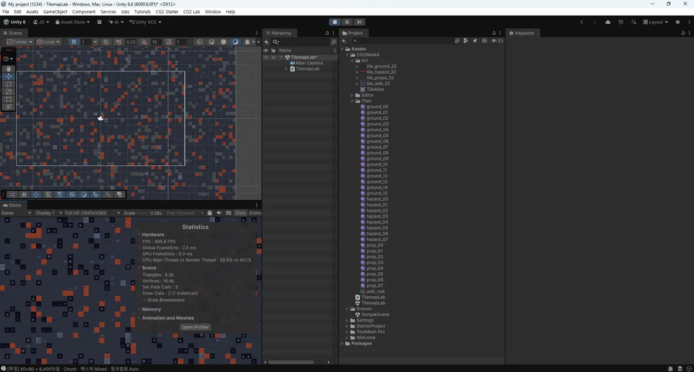
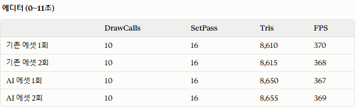
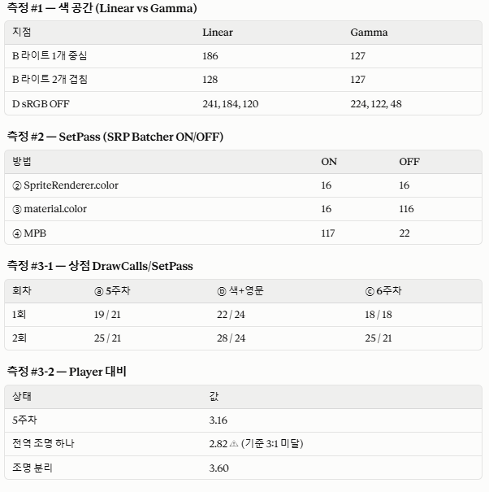
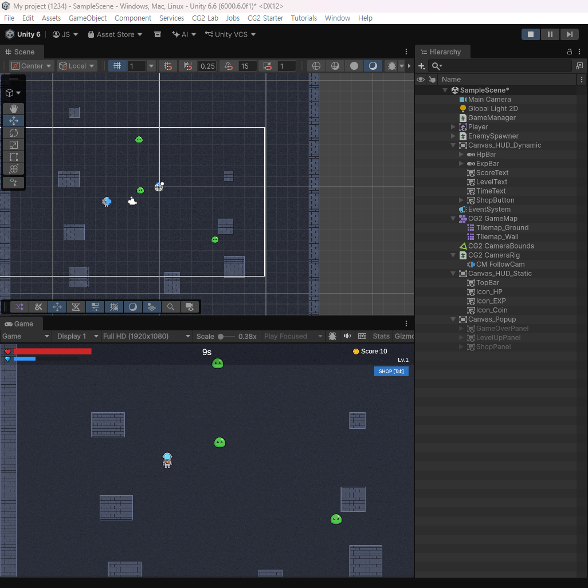

# WEB2D_20231406_PROJECT

Unity 2D 프로젝트입니다.

## 프로젝트 개요
- 2D 게임 프로젝트 개발 실습용 저장소
- Unity 엔진 기반으로 제작
- 게임 로직, 씬 구성, 오브젝트 제어 등을 학습 및 구현

## 개발 환경
- Unity
- C#
- GitHub

## 실행 방법
1. Unity Hub에서 이 프로젝트를 열기
2. 해당 씬을 로드
3. Play 버튼을 눌러 실행

## 저장소 정보
- GitHub: https://github.com/sonjeonghee12/WEB2D_20231406_PROJECT

## 참고
- 본 프로젝트는 교육/실습용으로 구성되었습니다.

## 3주차 간단문제 풀기

g

# Q & A

• 오늘의 핵심 정리

• 오브젝트 수와 Draw Call 수는 항상 같은 값이 아니다.

• SRP Batcher는 Draw Call을 감소 x, CPU 렌더링 준비 비용을 줄이는 기
술이다.

• Sprite Atlas는 텍스처를 통합해 배칭 조건을 개선할 수 있지만, 메모리
증가와 같은 대가가 발생한다.

• SRP Batcher에 Sprite Atlas의 조합은 실제 성능 테스트를 통해 검증해
야 한다.

## 4주차 간단문제 풀기

 추가분석

기존 #3번 조건(Chunk · Texture Spread Mixed)은 바닥·벽·장식·위험 타일시트 4장을 섞어 쓰기 때문에, 청크마다 참조하는 텍스처가 달라져 DrawCalls가 5개까지 늘어났다. 같은 머티리얼을 쓰더라도 참조하는 텍스처가 다르면 배칭이 끊어지기 때문이다.

여기에 Sprite Atlas를 적용한 #6번 조건에서는 4장의 텍스처시트가 하나의 Atlas 텍스처로 합쳐지면서, 청크들이 다시 동일한 텍스처를 참조하게 되어 DrawCalls가 5 → 2로 줄어들었다. 이는 #1번(Single 텍스처) 조건과 정확히 동일한 수치로, Atlas 적용이 결과적으로 "텍스처 종류를 1종으로 통합"한 것과 같은 효과를 낸다는 것을 실측으로 확인할 수 있었다.

Tris(삼각형 수)는 #3(8,192)과 #6(8,192) 사이에 변화가 전혀 없었다. 이는 Sprite Atlas가 지오메트리(타일 개수·모양)에는 영향을 주지 않고, 오직 텍스처 참조만 통합하는 최적화 기법이기 때문이다. 즉 컬링(Tris 감소)과는 완전히 다른 축의 최적화이며, 3주차에서 배운 "Sprite Atlas = 텍스처 통합으로 배칭 조건 개선"이 타일맵 렌더링에도 동일하게 적용됨을 확인했다.

FPS는 #3(362.9)에서 #6(405.9)으로 약 12% 개선되었다. DrawCalls가 줄어든 만큼 CPU가 렌더 상태를 준비하는 비용(Set Pass Call 포함)이 감소한 결과로 해석할 수 있다.

# 스크린샷(1)

# 스크린샷(2)

# 스크린샷(6)

# Q & A

• 오늘의 핵심 정리

• Tilemap Renderer(Chunk)는 드로우 콜(Draw Call)을 최적화하는 기법
이다.
• 정렬이 필요없는 바닥과 벽은 Chunk 모드를 사용하고, 캐릭터와의 정렬이 중요한 오브젝트만 Individual 모드로 분리한다.

• 병목의 최우선 과제는 드로우 콜 및 SetPass Call 병목을 개선하는 것이다.

## 5주차 간단문제 풀기

# 스크린샷(1)

# 스크린샷(2)

ai모델 이미지

# Q & A

• 오늘의핵심정리

• 카메라: Orthographic Camera의 Size는 화면에 보이는 World Unit을 결정하고, Tilemap은 Chu nk 단위로 컬링되어 Tris가 조금씩 변한다.

• UI : Canvas 분리는 GPU 드로우콜과 CPU 재구성 범위 사이의 선택이다.

• 에셋: AI 이미지는 원본점검(배경· 워터마크· 바닥) → 가공(PPU 64 · 알파 정리) → 프로젝트 규격에 맞는 텍스텨 설정을거쳐야쓸수있다.

• 성능: 규격을맞춘에셋교체는DrawCalls · GPU 메모리를 바꾸지 않는다. 비교는 같은 환경 안에서, 같은 구간을, 여러 번 측정해야 한다.